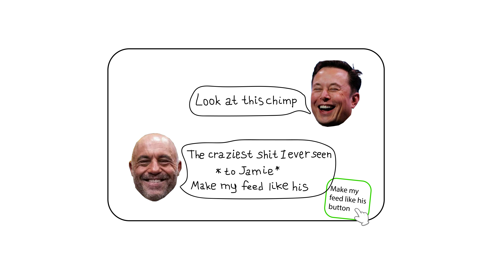

<p align="center">

</p>

# Caught & Shared

*People borrow taste from people. Why shouldn't recommendations?*

**Website**: https://rjeyskey.github.io/Caught-and-Shared/

**Paper**: [caught-and-shared-conscious-control-in-recommender-systems.pdf](caught-and-shared-conscious-control-in-recommender-systems.pdf)

**Pitch (2 min)**: eng https://www.youtube.com/watch?v=QtJTm5fp5rY · rus https://www.youtube.com/watch?v=O5XaG_wbHDI

---

## What is Caught & Shared?

Modern recommendation systems figure you out from what you *do*. They watch your clicks, your searches, your history — and try to guess your taste.

Caught & Shared is a different idea:

> **What if you could explicitly choose *whose* taste influences your recommendations?**

You know that friend whose finds are always perfect? Or that person who is *the* authority on sneakers? Instead of hoping an algorithm figures you out, you just **borrow their taste** — pick the person, pick how strongly their taste mixes into yours, and your feed follows. No retraining anything, no changing the engine. A layer on top, a dial in your hand.

Choose who influences your recommendations.
Share taste.
Build recommendation systems together.

---

## How it works (in plain words)

1. **You pick a mentor** — a person whose taste you trust (a friend, a creator, someone you admire).
2. **You set the strength** — how much of their taste comes into your feed:
   - **Light (20%)** — a gentle nudge toward their style
   - **Balanced (45%)** — a real mix of both tastes
   - **Deep (70%)** — strong immersion into their world
3. **You watch your feed shift** — and you can always pull back. One tap returns you to "pure me" (your old feed, exactly as it was). Every setting is visible, adjustable, and reversible.

That's the whole product idea: **visible, controllable influence, with an easy undo.**

And the natural next step — assign *different* mentors to *different parts of your life*: sneakers → your sneakerhead friend, home stuff → your designer friend, work gear → your techie friend. One person doesn't own your taste; your "mentor team" does.

---

## What's in this repository

```
code-ground-truth/
├── src/cs_core/        ← THE ENGINE: the actual code that blends tastes (pure Python, no heavy deps)
├── scripts/            ← READY-TO-RUN experiments (the numbers below come from these)
├── applications/       ← RESEARCH NOTEBOOKS: 6 different technical directions we explored (for the curious)
├── data/test_results/  ← THE RESULTS: honest JSON numbers from the experiments
├── docs/               ← HOW AND WHY we made decisions (glossary, ADR log)
├── assets/  index.html ← the public landing page + figures
└── README.md           ← you are here
```

Not sure where to start?

- **I want to see the numbers** → `data/test_results/`
- **I want to run it myself** → `scripts/` (see "Run it" below)
- **I want to understand the engine** → `src/cs_core/`
- **I want the full technical background** → `docs/adr/`, `GLOSSARY.md`
- **I want to see the whole research story** → `applications/` (notebooks)

---

## What we've already tested

Two honest experiments are on disk in `data/test_results/`:

**1. Real data: MovieLens** (100k real movie ratings).
We took warm users, picked a "mentor" for each (someone whose taste overlaps theirs), and blended the mentor's taste in at 20–70%.
Result: recommendation quality **went up, not down** — up to **+2.5% NDCG@10** at α=0.7, +1.9% at α=0.45, +0.2% at α=0.2. The more taste you borrow, the better the feed gets (within reason).

**2. Simulated marketplace** (12 life categories: sneakers, home, tech…).
We gave a user a mentor for a category they barely interact with.
Result: their feed's category coverage **grew (+8% of categories)** while relevance stayed flat — i.e. **blending adds new worlds to explore without breaking what already worked.** That's the "do no harm + discover more" proof.

> The honest caveat: these are offline experiments on a small scale — the mechanism works and nothing breaks, but "people feel more in control" still needs the user study that's next on the roadmap.

---

## Run it

Two commands, no GPU, no heavy installs (needs Python 3.10+ with numpy, pandas, gensim):

```bash
# 1) Real-data experiment (MovieLens) — ~4 minutes
python scripts/01_embedding_blending_movielens.py

# 2) Storytelling experiment (synthetic marketplace) — seconds
python scripts/02_multicategory_mentors_synthetic.py
```

That's the whole engine: **blend two taste-vectors with a dial.** Everything else in the codebase exists to measure, explain, and improve that one move.

There's also an interactive visual prototype (drag the α dial over a movie grid) — locally at the sibling folder `caught-shared-demo/demo/` (not yet part of this repo).

---

## The bigger vision: Conscious Recommendations

Caught & Shared is the first step of a broader family of products — **Conscious Recommendations**: recommendation systems where the user is in control, can see what influences their feed, and can change or undo it at any time.

- Today: one mentor, one dial, one undo button.
- Next: a personal "Mentor Team" — different trusted people for different life categories.
- Later: the same conscious layer applied to any feed you use — marketplace, music, video, news.

This turns recommendations from a passive black box into an **honest, human, explainable** experience.

---

## For the technically curious (the research map)

We explored six ways to inject a mentor's taste into a recommender. Three families:

1. **Changing the graph** — adding mentor connections directly into the user-item graph
   (heterogeneous graph, dual graph, metapath, virtual proxy items).
   *Strong but invasive: it changes the core model. Status: research appendix.*
2. **Contrastive training** — pulling a user's embedding toward their mentor's during training.
   *Softer influence, needs mentor data in training. Status: auxiliary option.*
3. **Embedding blending** — mixing the taste vectors at recommendation time: `your_feed = (1-α)·you + α·mentor`. ✅
   *Simple, instant, reversible, doesn't touch the existing system. **This is the product.***

We keep all notebooks in `applications/` so the full story stays alive; the engine we ship and pitch is #3. The why-behind-each-choice is logged in `docs/adr/` — written for the next person (or future us) who asks "why did you choose this?"

**Sources** (the science behind the choice): mentor-based cold-start (Brun et al. 2011), user control & satisfaction (Harper et al. 2015; Mysore et al. 2023), multi-interest user models (ComiRec 2020; GemiRec 2024), social learning for matters of taste (Analytis et al. 2018). Full provenance lives in the Obsidian ground-truth workspace.

---

*Previous versions of this README live in git history (`git log --oneline -- README.md`) — you can always roll back.*